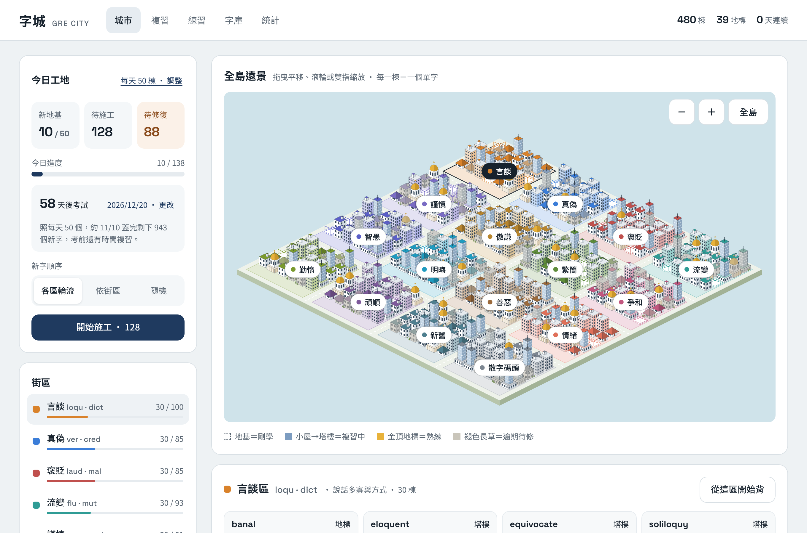
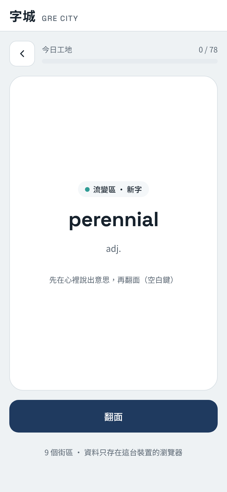
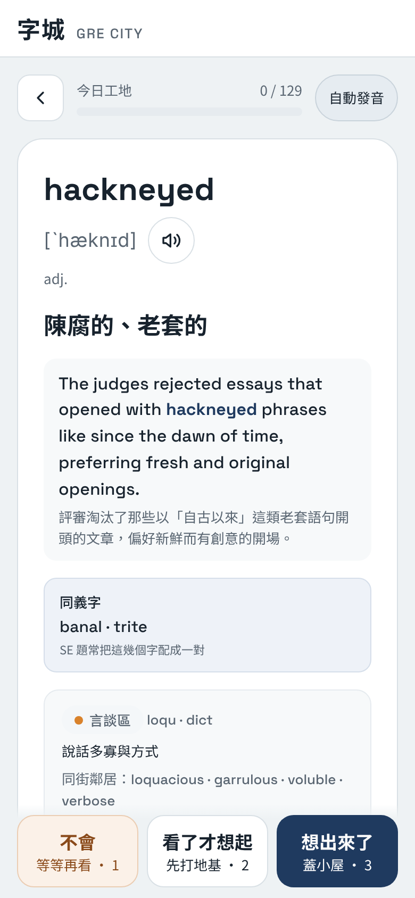
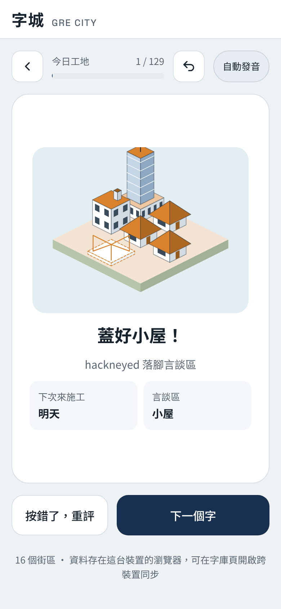
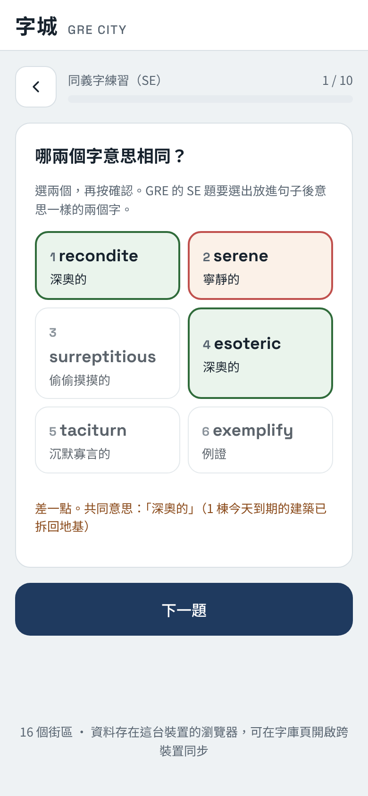
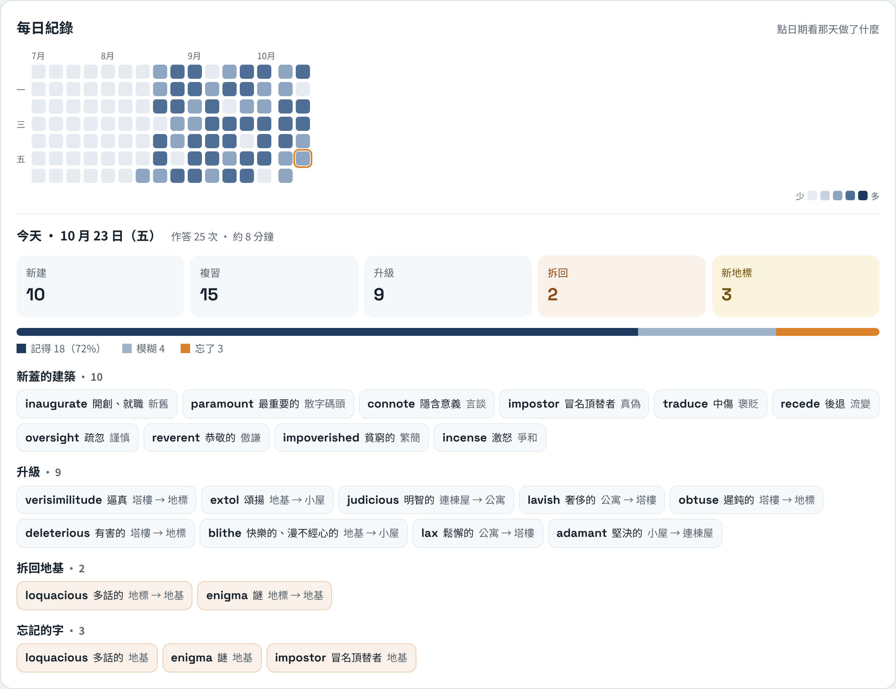
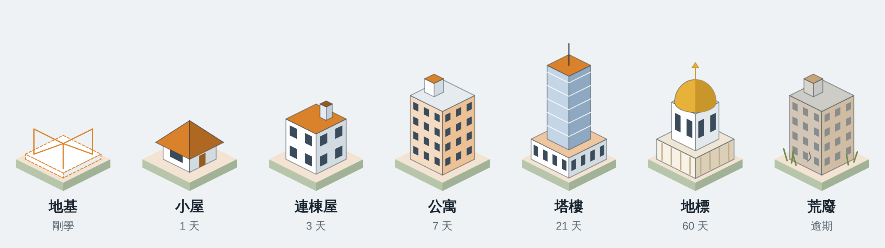
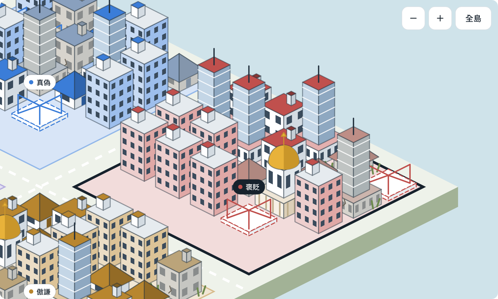
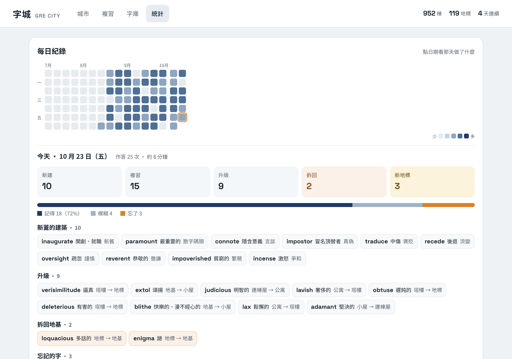

# 字城 GRE City

線上版：https://voho0000.github.io/GRE-city/



> 每個人的城市存在自己的瀏覽器裡（IndexedDB），沒有共用的伺服器。別人打開網址，看到的是一座空城，他背的字只會蓋在他自己的城市，碰不到你的。

背一個 GRE 單字，城市就多一棟建築。複習答對，建築就升級成下一種；太久沒複習，建築會褪色、長草。

## 怎麼玩

- **城市**：等角視角的島分成 4×4 共 16 個街區：言談、真偽、褒貶、流變、謹慎、傲謙、繁簡、爭和、智愚、明晦、善惡、情緒、勤惰、頑順、新舊，還有「散字碼頭」放不屬於這些主題的字。意思相近或相反的字住在同一區，方便對付 SE 同義字題。每棟建築就是一個單字，可拖曳、縮放，點建築看它的狀態。
- **複習**：卡片正面只有單字、KK 音標和發音，不顯示街區，避免先猜到意思的方向。翻面後自評「不會／看了才想起／想出來了」，背面列出同義字，作答後馬上看到建築的變化。按錯可以「上一步」收回。發音在 iPhone／iPad 預設用線上真人錄音（不受靜音開關影響），其他裝置用內建語音、唸不出來時改播錄音；統計頁可切換發音來源。鍵盤：空白鍵翻面，P 發音，1／2／3 評分，Z 上一步，Enter 下一個。
- **同義字練習（SE）**：六個字選出意思相同的兩個，題目從你蓋過的字和它們的同義字自動產生。只有今天到期的字會因作答升級或拆回，練習不會打亂複習排程。
- **考試倒數**：在「今日工地」設定 GRE 日期，會算出要在考前兩週背完所有新字，每天至少要幾個，不夠時可一鍵調整。
- **複習積太多時先修復**：到期的複習達到每日新字數的 3 倍（至少 60 棟）時自動暫停新字，降回門檻以下就恢復；可在統計頁關掉。
- **字庫**：貼上 CSV 或從試算表複製匯入（第一列寫欄位名稱：`word, zh, pos, kk, example, district`，只有 word 和 zh 必填）。沒填街區的字會依字根和中文意思自動分區，之後也能手動改。這裡也可以下載和還原備份。
- **跨裝置同步**：在字庫頁貼上一個只有 `gist` 權限的 GitHub token，進度就會存到你帳號的秘密 Gist。電腦和手機都貼同一個 token，打開 App、背完一輪、切到別的 App 時會自動同步；兩邊都背過的字逐字合併，以最後一次作答為準，不會互相覆蓋。
- **統計**：「每日紀錄」日曆（近 16 週，顏色越深作答越多），點任一天看那天新蓋了哪些字、哪些升級或拆回、哪些字不會、三種評分的比例，以及大約背了幾分鐘。下方還有建築分布、各街區狀況和最常拆的字。
- **每日新字數**：第一次打開時自己選（10／20／30／50 或自訂），之後在首頁「今日工地」隨時可改。
- **新字順序**：在「今日工地」選「各區輪流」（預設）、「依街區」（指定一區先背完，也可在街區詳情按「從這區開始背」）或「隨機」（每天重新洗牌，當天順序固定）。只影響新字；到期的複習一定會出現。

<p>
  
  
  
</p>

**同義字練習（SE）**：六個字選出意思相同的兩個，答完顯示每個字的中文和共同意思。

<p></p>

**統計頁的每日紀錄**：點日曆上任一天，看那天蓋了什麼、升級和拆掉了哪些、哪些字不會。



## 建築與複習間隔



| 等級 | 建築 | 下次複習 |
| --- | --- | --- |
| 0 | 工地（地基＋鷹架） | 明天 |
| 1 | 斜屋頂小屋 | 1 天 |
| 2 | 連棟屋（煙囪） | 3 天 |
| 3 | 公寓（水塔） | 7 天 |
| 4 | 塔樓（玻璃帷幕） | 21 天 |
| 5 | 金頂地標 | 60 天 |

- 想出來了：升一級。
- 看了才想起：等級不變，間隔減半。
- 不會：拆回地基，同一輪稍後會再出現一次。
- 過了複習日：建築褪色。
- 逾期超過一個間隔：建築長草，必須先答對一次「修復」才能再升級。

<p>
  
  
</p>

## 開發

```bash
npm install
npm run dev      # 本機開發
npm test         # 單元測試
npm run build    # 輸出到 dist/，可直接放上任何靜態網站主機
```

技術：React + Vite + TypeScript。城市用 SVG 繪製，資料存在瀏覽器的 IndexedDB，沒有後端；跨裝置同步直接呼叫 GitHub Gist API。打包後可當 PWA 安裝到手機。內建 1,423 個 GRE 高頻字，每區約 90 字，都附中文、詞性和 KK 音標；解釋和音標是自行撰寫，不取自任何市售字表。

## 部署

推到 `main` 會自動跑測試、打包，並部署到 GitHub Pages（`.github/workflows/deploy.yml`）。第一次使用前，要在 repo 的 Settings → Pages → Build and deployment → Source 選 **GitHub Actions**。
